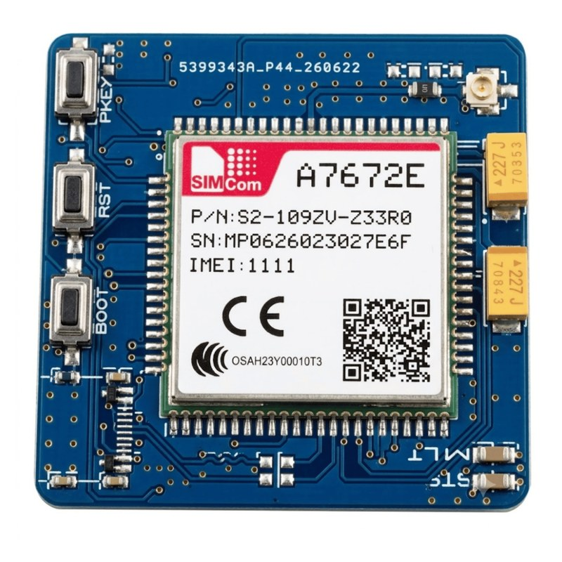
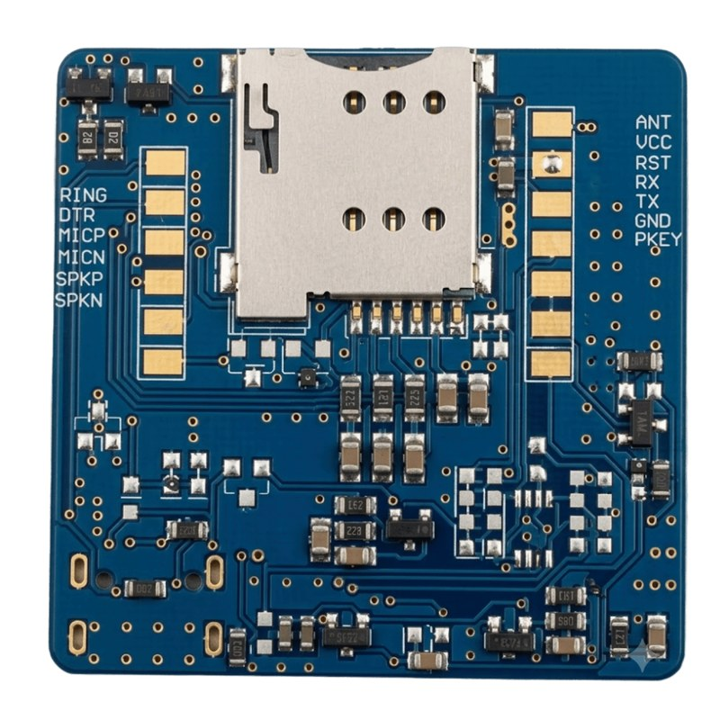

# ESP32-S3 + SIM7672E 4G LTE Cat-1 Geliştirme Kiti

<p align="center">
  
  
</p>

> **📦 Ürün:** [**SIM7672E 4G LTE Cat-1 GSM Modül — SIMCom IoT Haberleşme Modülü**](https://www.hiber.com.tr/sim7672e-4g-lte-cat-1-gsm-modul--simcom-iot-haberlesme-modulu)

[](LICENSE)
[](https://www.espressif.com/)
[](https://www.arduino.cc/)
[](https://www.hiber.com.tr/sim7672e-4g-lte-cat-1-gsm-modul--simcom-iot-haberlesme-modulu)

**SIM7672E 4G LTE Cat-1** modülü için 10 bağımsız örnek proje:
HTTP · TCP · UDP · MQTT · SMS · DTMF · Röle · Sıcaklık · Hücresel Konum

> ✅ **Tüm projeler ESP32-S3 + SIM7672E donanımı üzerinde test edilmiştir.**

**Geliştirici:** [Hiber Bilişim](https://www.hiber.com.tr) — [hibersoft.com.tr](https://www.hibersoft.com.tr)

---

## 📖 İçindekiler

1. [Projeler](#-projeler)
2. [Donanım](#-donanım)
3. [Derleme](#-derleme)
4. [Mimari](#-mimari)
5. [Proje Detayları](#-proje-detayları)
6. [Test Sunucusu](#-test-sunucusu)
7. [SIM7672E AT Komut Farkları](#-sim7672e-at-komut-farkları)
8. [Klasör Yapısı](#-klasör-yapısı)
9. [Lisans](#-lisans)

---

## 📋 Projeler

| # | Proje | Sınıf | İçerik |
|:-:|-------|-------|--------|
| 01 | `01_SerialTest` | `SerialTest` | Modem tanılama, IMEI/IMSI, SIM, sinyal, operatör, kayıt, etkileşimli AT konsolu |
| 02 | `02_HTTPTest` | `HttpTest` | LTE veri + HTTP POST (token alma ve veri gönderimi) |
| 03 | `03_TCPTest` | `TcpTest` | TCP soket üzerinden JSON gönderme/alma |
| 04 | `04_UDPTest` | `UdpTest` | UDP paket gönderme/alma |
| 05 | `05_MQTTTest` | `MqttTest` | Ham TCP üzerinde MQTT 3.1.1 (connect, publish, subscribe) |
| 06 | `06_SmsTest` | `SmsTest` | SMS gönderme, listeleme, okuma, alma, silme |
| 07 | `07_SmsRelayControl` | `SmsRelay` | SMS komutuyla 2 kanal röle kontrolü |
| 08 | `08_DtmfRelayControl` | `DtmfRelay` | Arama + DTMF tuşlarıyla 2 kanal röle kontrolü |
| 09 | `09_SmsTemperature` | `SmsTemperature` | DS18B20 sıcaklık değerini SMS ile bildirme |
| 10 | `10_LbsLocation` | `LbsLocation` | GPS'siz, baz istasyonu tabanlı konum (LBS) |

---

## 🔌 Donanım

### Modem Bağlantıları

| ESP32-S3 GPIO | SIM7672E | Açıklama |
|:-------------:|:--------:|----------|
| **17** | RX | ESP32 TX → Modül RX |
| **16** | TX | ESP32 RX ← Modül TX |
| **7**  | PWRKEY | Güç açma/kapama |
| **5**  | RESET | Donanım sıfırlama |
| GND | GND | Ortak toprak |

```cpp
gsm(17, 16, 7, 5);   // TX, RX, PWRKEY, RESET
```

### Çevre Birimi Pinleri

| Kullanım | GPIO | Proje |
|----------|:----:|-------|
| Röle 1 | 6 | 07, 08 |
| Röle 2 | 15 | 07, 08 |
| DS18B20 Data | 13 | 09 |
| Onboard LED (aktif-düşük) | 48 | Tümü (kapalı tutulur) |

### PWRKEY / RESET Kutupluluğu

Modülde `PWRKEY` ve `RESET` aktif-düşüktür. Kart üzerinde bu pinler NPN transistörle sürüldüğü için GPIO mantığı terstir. Her projenin `.h` dosyasında:

```c
#define PWRKEY_ACTIVE_HIGH  1   // 1 = NPN sürücü (GPIO HIGH = tetik), 0 = doğrudan bağlantı
#define RESET_ACTIVE_HIGH   1

#define PWRKEY_ON_MS    1500    // Açma darbesi
#define PWRKEY_OFF_MS   3000    // Kapatma darbesi
#define PWRKEY_BOOT_MS  8000    // Darbe sonrası AT hazır olma süresi
```

### Hedef Kart

```
board = esp32-s3-devkitc-1  (N16R8)
16 MB Flash · 8 MB Octal PSRAM (OPI)
```

---

## 🏁 Derleme

Her proje kendi klasöründe bağımsız bir PlatformIO projesidir:

```bash
cd examples/05_MQTTTest
pio run -t upload
pio device monitor -b 115200
```

Ortak `platformio.ini`:

```ini
[env:esp32s3]
platform = espressif32
board = esp32-s3-devkitc-1
framework = arduino

board_build.flash_size = 16MB
board_build.psram_type = opi
board_build.arduino.memory_type = qio_opi
board_upload.flash_size = 16MB

build_src_filter = +<main.cpp> +<XX_Proje.cpp>

monitor_speed = 115200
upload_speed = 921600
upload_port = /dev/ttyACM0
monitor_port = /dev/ttyACM0
```

`09_SmsTemperature` ek olarak `paulstoffregen/OneWire` ve `milesburton/DallasTemperature` kütüphanelerini kullanır (`lib_deps` ile otomatik iner).

---

## 🏗️ Mimari

Ortak bir kütüphane yoktur; her proje yalnızca kendi ihtiyaç duyduğu AT komutlarını içeren kendi sınıfıyla gelir.

```
examples/05_MQTTTest/
├── platformio.ini
└── src/
    ├── main.cpp          ← Uygulama akışı
    ├── 05_MQTTTest.h     ← Sınıf bildirimi, pin ve zaman aşımı tanımları
    └── 05_MQTTTest.cpp   ← AT komut implementasyonu
```

### Tüm Sınıflarda Ortak Fonksiyonlar

| Fonksiyon | Açıklama |
|-----------|----------|
| `begin(baud)` | UART2'yi başlatır, modem yanıt vermezse PWRKEY ile açar |
| `hardReset()` | RESET pini ile donanım sıfırlama + `begin()` |
| `powerOn()` / `powerOff()` | PWRKEY ile açma/kapama |
| `powerKeyPulse(ms)` | Ham PWRKEY darbesi |
| `sendAT(cmd, timeout)` | AT komutu gönderir, yanıtı `String` döndürür |
| `sendATExpect(cmd, beklenen)` | Yanıtta beklenen metin var mı (`bool`) |
| `waitForResponse(beklenen)` | Beklenen metni bekler |
| `clearBuffer()` | Seri tamponu boşaltır |
| `getSignalQuality()` | CSQ (0–31, 99 = ölçülemedi) |
| `isRegistered()` | `AT+CEREG?`, ardından `AT+CREG?` |
| `getSIMStatus()` | `READY` / `PIN_REQUIRED` / `PUK_REQUIRED` / `NOT_INSERTED` |
| `getOperator()` | Operatör adı |
| `setDebug(bool)` | AT trafiğini `[TX]` / `[RX]` etiketiyle Serial'e yazar |

### Zaman Aşımı Tanımları

```cpp
#define AT_TIMEOUT        3000   // Genel AT komutları
#define GPRS_TIMEOUT     15000   // PDP context
#define HTTP_TIMEOUT     28000   // HTTP istekleri
#define MQTT_TIMEOUT     10000   // MQTT
#define SMS_SEND_TIMEOUT 60000   // SMS gönderimi
#define LBS_TIMEOUT      45000   // AT+CLBS
```

---

## 📚 Proje Detayları

### 01 — SerialTest

Sırasıyla: modem başlatma → IMEI → IMSI → SIM durumu → CSQ/RSSI → operatör → LTE kaydı. Ardından Serial Monitor'dan yazılan her satır AT komutu olarak modeme gönderilir.

```cpp
SerialTest gsm(17, 16, 7, 5);
gsm.begin();
gsm.getIMEI();
gsm.getIMSI();
gsm.getSIMStatus();
gsm.getSignalQuality();
```

### 02 — HTTPTest

Akış: modem → LTE kaydı → `initGPRS(APN)` → token menüsü → 60 sn boyunca 5 sn'de bir `POST /ingest`.

```cpp
gsm.initGPRS("internet");
gsm.getToken(token, clientId);                         // POST /token
gsm.postIngest(token, deviceId, json, cevap, httpKod); // POST /ingest, x-api-key başlığı
```

Token menüsü (02–05 ortak):

| Seçim | İşlem |
|:-----:|-------|
| 1 | `SAVED_TOKEN` / `SAVED_CLIENT_ID` sabitlerini kullan |
| 2 | Sunucudan otomatik al (`POST /token`) |
| 3 | Serial Monitor'dan elle gir |

### 03 — TCPTest

`test.hibersoft.com.tr:2885` adresine TCP bağlantısı açar; 60 sn boyunca 5 sn'de bir `\n` ile biten JSON satırı gönderir ve yanıtı okur. Token JSON gövdesindedir.

```cpp
gsm.tcpConnect("test.hibersoft.com.tr", 2885);
gsm.tcpSend(json + "\n");
String veri = gsm.tcpReceive(3000);
gsm.tcpClose();
```

### 04 — UDPTest

`test.hibersoft.com.tr:2886` adresine UDP paketleri gönderir. Bağlantı `AT+CIPOPEN=0,"UDP",host,port,0`, gönderim `AT+CIPSEND=0,<len>,"host",port` ile yapılır.

```cpp
gsm.udpConnect("test.hibersoft.com.tr", 2886);
gsm.udpSend(json);
String veri = gsm.udpReceive(3000);
gsm.udpClose();
```

### 05 — MQTTTest

Harici kütüphane kullanmadan, TCP soket üzerinde MQTT 3.1.1 paketleri oluşturulur. Remaining Length değişken uzunluklu kodlanır; QoS 0.

```cpp
gsm.mqttConnect("test.hibersoft.com.tr", 2887, deviceId, "testuser", "PUBLIC_MQTT_2026_PASS");
gsm.mqttSubscribe("test/esp32/cmd");
gsm.mqttPublish("test/esp32/sensor", json);
String gelen = gsm.mqttLoop(100);   // "topic: payload"
gsm.mqttPing();
gsm.mqttDisconnect();
```

| Parametre | Değer |
|-----------|-------|
| Broker | `test.hibersoft.com.tr:2887` |
| Kullanıcı / Şifre | `testuser` / `PUBLIC_MQTT_2026_PASS` |
| Publish topic | `test/esp32/sensor` |
| Subscribe topic | `test/esp32/cmd` |

### 06 — SmsTest

6 adımlı test: başlat → gönder (`AT+CMGS`) → listele (`AT+CMGL`) → oku (`AT+CMGR`) → gelen SMS bekle (`AT+CNMI`, `+CMT:`) → tümünü sil (`AT+CMGD=1,4`).

```cpp
gsm.smsSend("+90XXXXXXXXXX", "Merhaba!");
String liste = gsm.smsList("ALL");
String msj   = gsm.smsRead(1);
gsm.smsSetIncoming(true);
String gelen = gsm.smsWaitIncoming(30000);
gsm.smsDeleteAll();
```

### 07 — SmsRelayControl

Gelen SMS `smsPoll()` ile dinlenir; komut büyük/küçük harf ve boşluk farkı gözetmeden eşleştirilir. Her komuttan sonra onay SMS'i gönderilir.

| Komut | İşlem |
|-------|-------|
| `R1 AC` / `ROLE1 AC` | Röle 1 açık |
| `R1 KAPAT` / `ROLE1 KAPAT` | Röle 1 kapalı |
| `R2 AC` / `ROLE2 AC` | Röle 2 açık |
| `R2 KAPAT` / `ROLE2 KAPAT` | Röle 2 kapalı |
| `HEPSI AC` | İki röle açık |
| `HEPSI KAPAT` | İki röle kapalı |
| `DURUM` | Röle durumları SMS ile |

Yapılandırma (`main.cpp`):

```cpp
#define R1_PIN  6
#define R2_PIN  15
#define RELAY_ACTIVE_HIGH          // tanımlı: HIGH = röle açık
#define YETKILI "+90XXXXXXXXXX"    // boş: tüm numaralar kabul edilir
```

### 08 — DtmfRelayControl

Modem numarası arandığında çağrı yanıtlanır ve tuşlar `+RXDTMF:` URC'si ile okunur. İnternet bağlantısı kullanılmaz.

| Tuş | İşlem |
|:---:|-------|
| `1` / `2` | Röle 1 aç / kapat |
| `3` / `4` | Röle 2 aç / kapat |
| `*` / `0` | Hepsini aç / kapat |
| `9` | Durumu Serial'e yaz |
| `#` | Aramayı kapat |

Durum makinesi:

```
IDLE → RINGING (RING) → CLIP (arayan kontrolü) → IN_CALL (DTMF) → IDLE (HANGUP / # / süre doldu)
```

| Tanım | Değer | Açıklama |
|-------|:-----:|----------|
| `YETKILI` | numara | Yalnız bu numara yanıtlanır; boşsa herkes |
| `MAKS_CAGRI_MS` | 120000 | Çağrı süresi üst sınırı |
| `CLIP_TIMEOUT_MS` | 4000 | CLIP gelmezse bekleme süresi |

```cpp
gsm.callSetCLIP(true);
gsm.callAnswer();   // ATA
gsm.callHangup();   // ATH
gsm.callPoll(olay, sizeof(olay), detay, sizeof(detay)); // RING | CLIP | DTMF | HANGUP
```

### 09 — SmsTemperature

DS18B20 (GPIO 13, 4.7 kΩ pull-up) okunur ve gelen SMS'e yanıt olarak gönderilir.

| Komut | Yanıt |
|-------|-------|
| `DURUM` | Sıcaklık + sinyal (CSQ) + sensör pini |
| Diğer her mesaj | Anlık sıcaklık |

```
DS18B20 VCC  → 3.3V
DS18B20 GND  → GND
DS18B20 Data → GPIO 13 + 4.7kΩ → 3.3V
```

### 10 — LbsLocation

Servis hücresi kimliği (`MCC` / `MNC` / `LAC-TAC` / `Cell ID`) okunur ve bu bilgiden konum hesaplanır. İki kaynak desteklenir:

1. **Modem içi LBS** — `AT+CLBS=1,1` (SIMCom konum sunucusu, anahtar gerektirmez)
2. **Online hücre veritabanı** — Unwired Labs (POST) veya OpenCelliD (GET), HTTPS

Varsayılan sıra önce `AT+CLBS`, ardından online sorgudur; `PREFER_ONLINE = true` sırayı tersine çevirir. Her iki yöntem de aktif PDP context kullanır. `AT+CLBS` başarılı olduğunda online sağlayıcı çağrılmaz.

Ayarlar (`main.cpp`):

```cpp
const char APN_STR[]     = "internet";
const char LBS_API_KEY[] = "";            // boş: yalnız AT+CLBS
const LbsProvider LBS_PROVIDER = LBS_UNWIRED;   // veya LBS_OPENCELLID
const bool PREFER_ONLINE = false;
const uint32_t LOOP_PERIOD_MS = 60000;
```

```cpp
CellInfo cell;
GeoFix   fix;
gsm.initGPRS("internet");
if (gsm.getLocation(fix, &cell)) {
    fix.lat; fix.lon; fix.accuracy;   // derece, derece, metre
    fix.source;                       // "CLBS" | "UNWIRED" | "OPENCELLID"
    gsm.mapsUrl(fix);                 // Google Maps bağlantısı
} else {
    fix.error;
}
```

| Fonksiyon | Açıklama |
|-----------|----------|
| `getCellInfo(CellInfo&)` | `AT+CPSI?`; eksik alanlar `AT+CEREG?` / `AT+COPS?` ile tamamlanır |
| `getRawCellReport()` | CPSI + CEREG + COPS + CSQ ham çıktısı |
| `lbsQueryModem(GeoFix&)` | `AT+CLBS` sorgusu |
| `lbsQueryOnline(CellInfo&, GeoFix&)` | Online veritabanı sorgusu |
| `getLocation(GeoFix&, CellInfo*)` | İki kaynağı sırayla dener |
| `setApiKey(key, provider)` | API anahtarı ve sağlayıcı |
| `setPreferOnline(bool)` | Sorgu sırası |
| `setUnwiredEndpoint(url)` | Unwired Labs bölge sunucusu |
| `mapsUrl(GeoFix&)` | Harita bağlantısı |

Teknik notlar:
- `AT+CLBS` yanıtı `<kod>,<boylam>,<enlem>,<doğruluk>` sırasındadır; enlem `|90|` sınırını aşarsa değerler otomatik takas edilir.
- HTTPS isteklerinde `AT+CSSLCFG="authmode",0,0` kullanılır (sertifika doğrulaması kapalı).
- `+HTTPACTION` **7xx** kodları SIMCom modemin iç hata kodlarıdır, sunucu yanıtı değildir.

| `+HTTPACTION` kodu | Anlamı |
|:------------------:|--------|
| `0` | Zaman aşımı |
| `301` / `302` | Yönlendirme |
| `401` / `403` | API anahtarı geçersiz / yetkisiz |
| `7xx` | Modem tarafı hata (istek sunucuya ulaşmadı) |

---

## 🌐 Test Sunucusu

02–05 numaralı projeler `test.hibersoft.com.tr` genel test sunucusunu kullanır.

| Protokol | Port | Endpoint |
|----------|:----:|----------|
| HTTP | 2884 | `POST /token` · `POST /ingest` |
| TCP | 2885 | JSON satırları (`\n` ile biter) |
| UDP | 2886 | JSON paketleri |
| MQTT | 2887 | Broker (`testuser`) |

Token alma:

```
İstek:  POST http://test.hibersoft.com.tr:2884/token
Gövde:  {}
Yanıt:  {"ok":true,"token":"406b...","clientId":"c_...","expiresAt":"...","ttlSec":86400}
```

| Protokol | Token konumu |
|----------|--------------|
| HTTP | `x-api-key` başlığı |
| TCP / UDP / MQTT | JSON gövdesindeki `"token"` alanı |

---

## 📌 SIM7672E AT Komut Farkları

Projelerde SIM7672E'ye özgü davranışlar aşağıdaki gibi ele alınmıştır:

| Konu | SIM800C / SIM800L | SIM7672E |
|------|:-----------------:|:--------:|
| LTE şebeke kaydı | `AT+CREG?` | `AT+CEREG?` |
| HTTP PDP context | `AT+HTTPPARA="CID",1` | Desteklenmez |
| HTTP veri okuma | `AT+HTTPREAD` | `AT+HTTPREAD=0,N` |
| HTTP + TCP eş zamanlı | Destekler | Desteklenmez (otomatik NETCLOSE/NETOPEN) |
| DTMF etkinleştirme | `AT+DDET=1,0,0,0` | Gerekmez |
| DTMF URC | `+DTMF: X` | `+RXDTMF: X` |
| UDP CIPOPEN | Uzak port | Yerel port parametresi zorunlu (`,0`) |
| UDP CIPSEND | Yalnız veri | Uzak host/port gerekli |
| Gelen soket verisi | `+IPD<conn>,<len>:<data>` | `+IPD<len>\r\n<data>` |

Uygulama içi çözümler:

| Konu | Çözüm |
|------|-------|
| MQTT Remaining Length > 127 | `_encodeRemLen()` ile çok baytlı kodlama |
| Binary veride `\0` baytı | `String` + `memcmp` ile bayt bazlı arama |
| `+CMT:` sonrası SMS gönderimi | `AT+CMGS` öncesi 300 ms, `>` sonrası 200 ms bekleme |
| `AT+CIPSEND` `>` istemi | Veri öncesi ~300 ms bekleme (05) |
| NPN sürücülü PWRKEY/RESET | `_pwrKeySet()` / `_resetSet()` + `*_ACTIVE_HIGH` tanımları |

---

## 📁 Klasör Yapısı

```
ESP32-SIM7672E-4G-LTE-Cat-1/
├── docs/
│   └── images/
├── examples/
│   ├── 01_SerialTest/
│   ├── 02_HTTPTest/
│   ├── 03_TCPTest/
│   ├── 04_UDPTest/
│   ├── 05_MQTTTest/
│   ├── 06_SmsTest/
│   ├── 07_SmsRelayControl/
│   ├── 08_DtmfRelayControl/
│   ├── 09_SmsTemperature/
│   └── 10_LbsLocation/
├── README.md
├── .gitignore
└── LICENSE
```

---

## 📄 Lisans

MIT © 2026 [Hiber Bilişim](https://www.hiber.com.tr)
